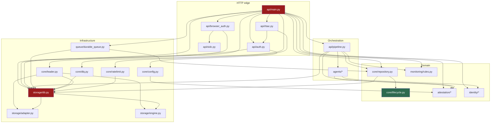
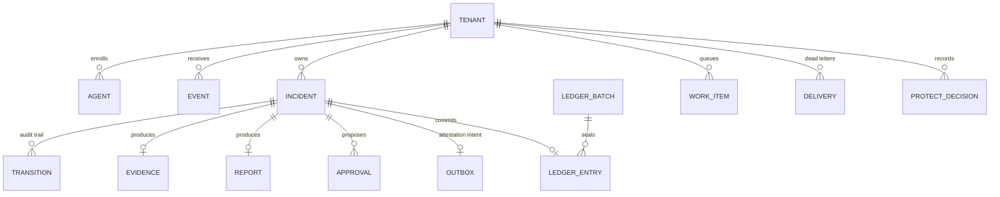
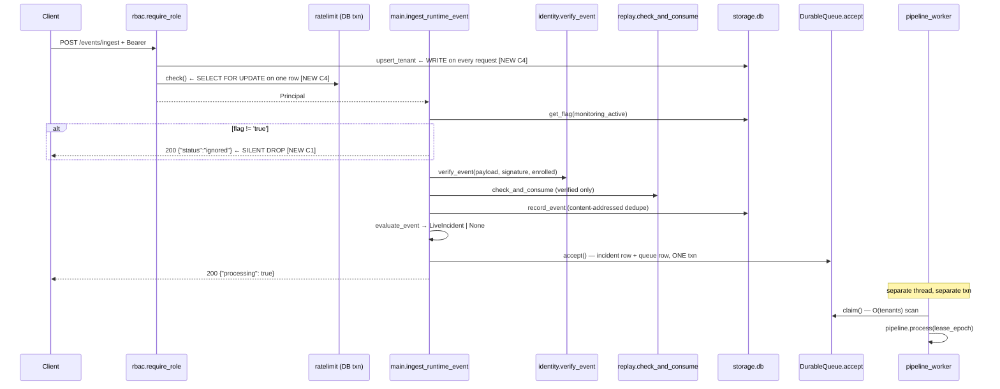
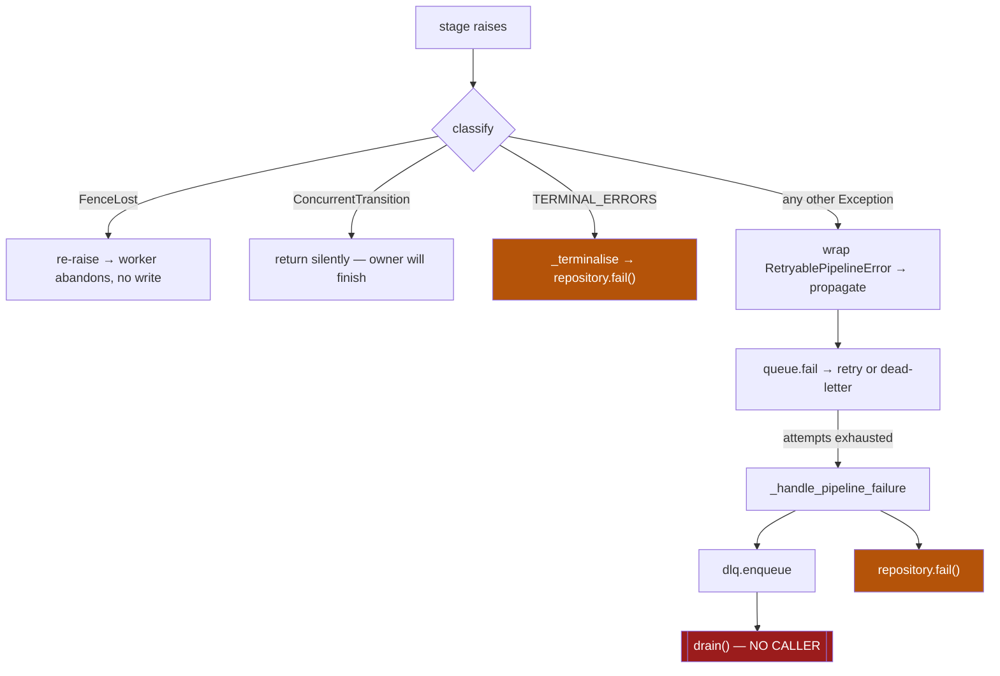
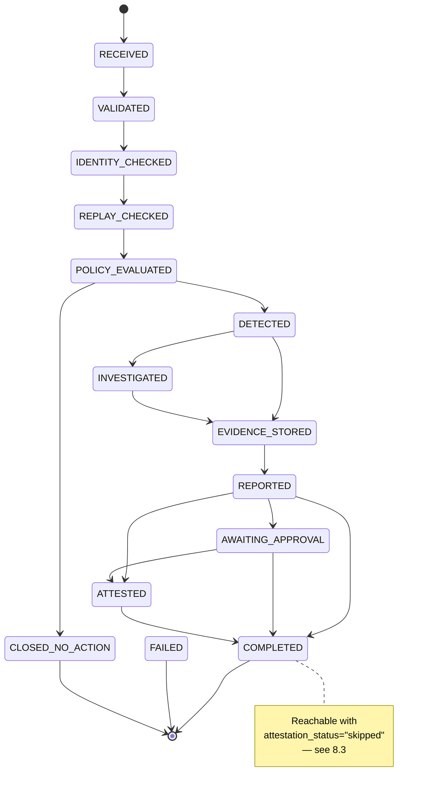
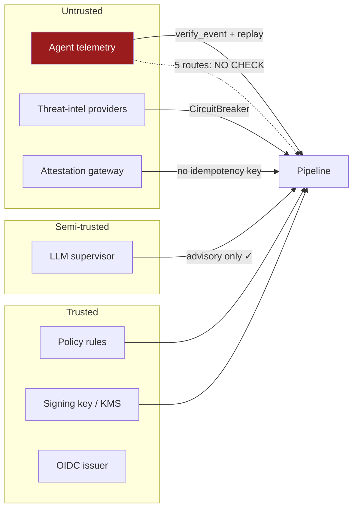
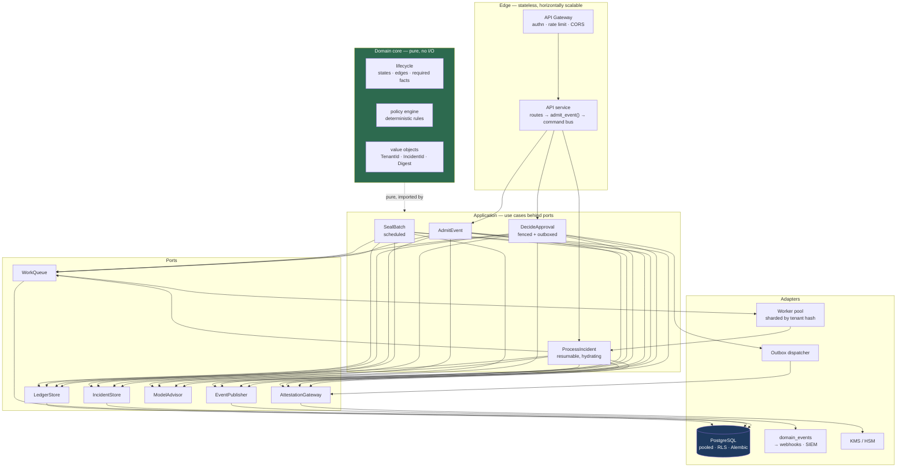

# Sentinel — Architecture Review & Target Architecture

<!-- unbacked-citations-retracted -->

> ## ⚠️ RETRACTION — the evidence column in this document is not backed by this repository
>
> **Added 2026-08-19 by an automated check, not by a reviewer's judgement.**
>
> `tests_arch/test_documentation_cites_real_tests.py` scans every document for
> test identifiers and requires each to resolve to a test `pytest` actually
> collects. It found that this document cites a **`tests/` directory that does
> not exist in this repository** — for example `test_board_v7_findings`, `test_council_v3_regressions` and
> `test_dashboard_xss`. The suite here lives in
> `tests_arch/`, and those files are not in it under any name.
>
> The commands in the Evidence column below therefore **cannot be run**, and the
> **Verified** statuses that rest on them are **not currently backed** by
> anything in this tree. They appear to describe the predecessor implementation
> that this codebase replaced.
>
> This is the same defect class as the F-4 retraction and the retention-sweep
> correction: *a claim of coverage with nothing behind it*. It is recorded here
> rather than deleted, because silently removing the rows would destroy the
> record of what was once claimed — which is the thing the F-4 retraction exists
> to preserve.
>
> **What is actually verified in this tree** is in
> [`PRODUCTION_READINESS_REPORT.md`](PRODUCTION_READINESS_REPORT.md), whose rows
> cite commands that run. Read that document, not this one, for current status.
>
> The unbacked citations are counted and ratcheted: they may be reduced by
> writing the test or deleting the row, and the count may not grow.

---


**Phase 0 deliverable. No code was modified.**

Scope: every production module under `agents/`, `api/`, `app/`, `sentinel_sdk/`, `evaluation/`,
plus schema, deployment manifests and the test corpus. ~27.4k LOC Python, 80 production modules,
1 HTML dashboard, 16 database tables.

Findings are cited `file:line`. Anything I could not verify by execution is marked
**[read-only]** — the suite was not run for this review and no cluster has ever run this code,
so all concurrency and scale findings are derived from source, not observed.

---

## Reading this document

Findings carry two independent axes:

| Axis | Meaning |
|---|---|
| **Severity** | C1 (data loss / silent wrong answer) · C2 (security) · C3 (availability) · C4 (scale ceiling) · C5 (maintainability) |
| **Class** | The *architectural* cause, not the instance. Fixing the instance leaves the class. |

Twenty findings in this review are **new** — not present in any of the eight prior council
reports. They are marked **[NEW]**. The concentration of new Critical findings in the *outer*
layers (routes, DLQ terminal operations, approval execution, connection lifecycle) is itself the
central diagnosis and is developed in §23.

---

# 1. Existing Architecture

## 1.1 What this system is

A single-process FastAPI monolith with in-process background threads, backed by one relational
database (SQLite or PostgreSQL through a hand-written dialect adapter), that ingests agent
telemetry, evaluates it against a deterministic policy, and produces a cryptographically
chained, optionally externally-anchored evidence record.

It is *described* as a five-agent AI SOC. It is *architecturally* a durable workflow engine with
one advisory LLM call and one shadow classifier, neither of which can influence any decision.
That gap between description and structure is the single most consistent theme of this review.

## 1.2 Layer map as built

```
┌─ Presentation ────────────────────────────────────────────────────────┐
│  dashboard/index.html   (1 file, ~1400 lines, hand-rolled DOM)        │
│  StaticFiles /dashboard  → guarded by browser_auth middleware         │
│  StaticFiles /evaluation → NOT GUARDED  (main.py:1197)     [NEW C2]   │
└───────────────────────────────────────────────────────────────────────┘
┌─ HTTP / Edge ─────────────────────────────────────────────────────────┐
│  api/main.py (1201 ln)  — 28 routes, module-level app, no router split │
│  api/rbac.py            — role gate + rate limit, per-request DB txn    │
│  api/auth.py            — API-key auth, WRITES to tenants per request   │
│  api/browser_auth.py    — OIDC PKCE session, CSRF, cookie minting       │
│  api/oidc.py            — JWT verification                              │
└───────────────────────────────────────────────────────────────────────┘
┌─ Orchestration ───────────────────────────────────────────────────────┐
│  api/pipeline.py        — resumable stage dispatcher (10 stages)        │
│  agents/*.py            — 6 "agents"; 1 makes an LLM call, rest are pure │
└───────────────────────────────────────────────────────────────────────┘
┌─ Domain ──────────────────────────────────────────────────────────────┐
│  app/core/lifecycle.py  — pure state machine (the only clean layer)     │
│  app/core/repository.py — the sole sanctioned mutator                   │
│  app/monitoring/rules.py, policy.py — detection gate                    │
│  app/attestation/*      — merkle, ledger, signing, redaction            │
│  app/identity/*         — signature recovery, replay defence            │
└───────────────────────────────────────────────────────────────────────┘
┌─ Infrastructure ──────────────────────────────────────────────────────┐
│  app/storage/db.py (1327 ln) — schema owner + 60 query functions        │
│  app/storage/adapter.py      — regex SQL dialect translation            │
│  app/queue/durable_queue.py  — DB-backed work queue, fenced leases      │
│  app/core/dlq.py             — DB-backed delivery queue                 │
│  app/core/leader.py          — pg advisory-lock leader election         │
│  app/core/ratelimit.py       — DB token bucket                          │
└───────────────────────────────────────────────────────────────────────┘
```

## 1.3 Process and thread topology

One OS process per replica contains:

| Thread | Started by | Lifetime | Notes |
|---|---|---|---|
| Uvicorn event loop | server | process | Serves all HTTP |
| Uvicorn threadpool (N) | server | process | Every route is `def`, not `async def`, except 6 |
| `pipeline_worker` | lifespan hook (`main.py:282`) | process | **Exactly one per replica** |
| `PeriodicJob(retention)` | lifespan hook | process | Leader-gated |
| `PeriodicJob(nonce_purge)` | lifespan hook | process | Leader-gated |

**There is exactly one pipeline worker thread per replica** (`main.py:282`). Pipeline
concurrency therefore equals replica count. With `replicas: 3`, the system processes at most
three incidents concurrently, and each holds a synchronous LLM call with a 20-second timeout.
Throughput ceiling ≈ 3 incidents per LLM round-trip. This is not documented anywhere.

## 1.4 What is *declared* but not *wired*

A recurring pattern with its own section (§16) because it is structural, not incidental:

| Component | Status |
|---|---|
| `dlq.drain()` | **Zero callers.** DLQ is write-only. **[NEW C1]** |
| `ContinuousMonitor` / `monitoring_task()` | Instantiated `main.py:311`, never started |
| `ledger.seal()` | Only reachable by manual `POST /attestation/seal` |
| `app/monitoring/monitor_loop.py` | No importer |
| `legacy_live_sources_manual.py`, `tmp_test_pipeline.py` | Dead at repo root |
| `BackgroundTasks` parameter | Accepted on 8 routes, used by none |

---

# 2. Component Dependency Graph

## 2.1 Actual import graph (production modules)



## 2.2 Structural readings

**`app/storage/db.py` is a god module.** 1327 lines, 60+ exported functions, imported by 14
modules across every layer. It owns the schema, all DDL, migrations, the RLS bootstrap, the
tenant directory, retention, metrics, and per-entity CRUD for 16 tables. Every layer depends on
it; it depends on nothing but the adapter. It is the single point through which all coupling
flows, which is why nothing in this system can be tested, replaced or scaled independently.

**`api/main.py` is a second god module.** 1201 lines containing route definitions, the worker
loop, failure handling, maintenance job registration, thresholds, severity mapping, filesystem
archiving, and static mounts. It imports from all four layers directly.

**Only one module is architecturally clean:** `app/core/lifecycle.py` (195 ln). Pure, no I/O, no
imports outside stdlib, fully testable in isolation. It is the reference for what the rest should
look like and is developed as such in §25.

## 2.3 Dependency-rule violations (Clean Architecture)

| # | Violation | Evidence |
|---|---|---|
| D-1 | Orchestration layer imports infrastructure directly, bypassing its own repository | `pipeline.py:73` imports `app.storage.db`; used at `:487` for `list_incident_approvals` |
| D-2 | Edge layer imports infrastructure directly | `main.py:49-50` imports `db`, `engine`; `main.py:626` calls `db.set_flag` from a route |
| D-3 | Infrastructure imports domain (inverted) | `durable_queue.py:143` does a function-local `from app.core import repository` to break an import cycle |
| D-4 | Config (infrastructure) imports attestation (domain) | `config.py:209` imports `RemoteSignerConfig` inside `load()` |
| D-5 | Domain imports edge schemas | `rules.py:25` imports `api.schemas`; `pipeline.py:64` likewise |

D-3 is the tell. A function-local import to break a cycle is the compiler telling you the layers
are inverted, silenced rather than heard.

---

# 3. Domain Model

## 3.1 The model as implemented



## 3.2 Aggregates — intended vs actual

There is exactly one true aggregate root: **Incident**. `repository.py` correctly enforces that
all mutation flows through it, transitions are checked against the state machine, and artifacts
commit in the same transaction as the state that asserts them (`repository.py:383-437`). This is
genuinely good design and is the strongest thing in the codebase.

But the aggregate boundary leaks in four places:

| # | Leak | Evidence |
|---|---|---|
| A-1 | `Approval` is mutated outside the Incident aggregate and outside the execution fence | `mitigation.py:144` calls `db.decide_approval` directly |
| A-2 | `Evidence` body is mutable and erasable independent of its incident | `db.redact_evidence` at `db.py:983` |
| A-3 | `LedgerEntry` is appended both inside the aggregate transaction (`repository.py:414`) **and** standalone (`ledger.py:65` → `db.append_ledger_entry`) | Two write paths to an append-only structure |
| A-4 | `Flags` (`monitoring_active`) is tenant-global mutable state read on the ingest hot path | `main.py:666` |

A-3 is the most serious. An append-only ledger with two independent append paths — one
transactional with the incident, one not — has no single point at which chain integrity is
guaranteed. The `UNIQUE(tenant_id, prev_chain_hash)` index makes a *fork* unstorable, but it
does not make the two paths agree about ordering.

## 3.3 Ubiquitous-language failures

The domain vocabulary is inconsistent in ways that have already produced defects:

- **"Attested"** means three different things: the lifecycle state `ATTESTED`, the
  `attestation_status` fact (which may be `"skipped"`), and the dashboard's "Anchoring batch
  root" label. `COMPLETED` is reachable with `attestation_status="skipped"` — see §15.
- **"Complete"** — `IncidentState.COMPLETED` vs `Incident.is_complete` vs the queue's `done`
  state vs DLQ `DONE`. Four independent notions of completion.
- **"Fail"** — `IncidentState.FAILED`, `repository.fail()`, `DurableQueue.fail()`, `dlq.fail()`.
  Four `fail()` functions with different semantics and different fencing guarantees. This is
  directly implicated in finding **F-2** (§10).
- **"Priority"** — mapped by `priority_from_severity` (`main.py:362`) *and*
  `priority_for_severity` (`rules.py:56`). Two implementations, different thresholds
  (`main.py` uses ≥85/70/40; `rules.py` uses the `SEVERITY_BANDS` table ≥85/70/40 — currently
  identical, structurally free to drift). `rules.py:57` claims to be "the ONLY place this
  mapping lives." It is not.

---

# 4. Data Flow

## 4.1 Ingest → incident (the `/events/ingest` path — the only complete one)



## 4.2 The other five ingest paths **[NEW C2 — the most serious security finding]**

`/ingest-event`, `/analyze`, `/ingest/agent-tool-call`, `/ingest/prompt-event`,
`/ingest/wallet-event` (`main.py:1058-1185`) all reach `accept_incident()` and therefore the
full pipeline, but **none of them**:

- call `verify_event()` — no identity verification, no `trust_level`
- call `check_and_consume()` — no replay protection
- call `db.record_event()` — no dedupe, and events never reach the `events` table
- call `evaluate_event()` — **no detection gate and no severity cap**
- check `monitoring_active`

The consequence is concrete. `main.py:1104-1111`:

```python
incident = build_base_incident(
    ...,
    severity=event.severity,     # ← client-supplied, verbatim
)
```

An `INGEST`-role key — the role explicitly documented as "what an instrumented agent gets…
write telemetry only" (`rbac.py:13`) — can `POST /ingest-event` with `severity: 100` and
manufacture a CRITICAL incident with `priority: CRITICAL`, bypassing:

- `UNVERIFIED_SEVERITY_CAP = 79` (`rules.py:42`), whose entire purpose per its own comment is
  "an unsigned caller can never manufacture a CRITICAL incident (Finding 6/18)"
- the `requires_verified_identity` rule mechanism
- replay defence
- deduplication

**The severity cap is enforced on one of six doors.** This is the same failure class as the XSS
finding — a control applied at the demonstrated sink while the claim generalised to the class —
and it sits on the authorization boundary rather than the rendering one.

Secondary consequence: because these paths never call `db.record_event()`, `db.metrics()`
`events_processed` counts only `/events/ingest` traffic. The dashboard's event counter
undercounts by however much traffic uses the other five routes.

## 4.3 Read path

Every read (`GET /incidents`, `/incidents/{id}`, `/metrics`, `/dlq`) is:
`require_role` → 1 connection for `upsert_tenant` → 1 connection for `ratelimit` (with row
lock) → 1..N connections for the query itself. **Minimum three Postgres connect/close cycles per
read request**, two of which are writes. See §12.

---

# 5. Event Flow

## 5.1 There is no event bus

Despite the "event-driven" framing in the README and the presence of `RuntimeEvent`,
`IngestedEvent`, an outbox table and a DLQ, **there is no event bus, no publish/subscribe, no
event log, and no consumer other than the single pipeline worker thread.** What exists:

| Mechanism | Type | Consumers |
|---|---|---|
| `work_queue` | Point-to-point job queue | 1 (pipeline_worker) |
| `attestation_outbox` | Transactional outbox, **read only by its own producer** | 0 external |
| `delivery_queue` (DLQ) | Dead-letter store | **0 — `drain()` uncalled** |
| `incident_transitions` | Append-only audit trail | Read-only projection |

## 5.2 The outbox is not an outbox

`attestation_outbox` (`repository.py:508-643`) implements the outbox *table* pattern but not the
outbox *dispatch* pattern. The intent row is written, then the **same worker, in the same call
stack**, immediately claims and delivers it (`pipeline.py:391-434`). There is no independent
dispatcher. If the worker dies between `claim_attestation` (state → `delivering`) and
`complete_attestation`, the row is stranded in `delivering` forever — nothing sweeps it. The
incident is left at `REPORTED`/`AWAITING_APPROVAL` and only recovers if the queue item is
reclaimed and the pipeline re-runs, which re-enters `claim_attestation` and overwrites the
`delivering` claim.

This is the mechanism behind the residual half of **H-4**: the outbox's `idempotency_key` is
generated (`repository.py:516`), stored, returned — and **never passed to the gateway**.
`publish_attestation` *accepts* the parameter (`attestation_agent.py:124`) and the sole call
site omits it (`pipeline.py:405-409`). The API was designed for idempotent delivery and the
wiring was not completed.

## 5.3 Missing event flows a production system requires

No domain events are emitted for: incident created, state changed, evidence sealed, approval
requested/decided, protect decision made, tenant onboarded, key rotated. Consequences: no
webhooks (`app/integrations/webhook.py` exists and is only reachable via mitigation), no SIEM
export, no streaming to the dashboard (it polls), no audit stream, no analytics.

---

# 6. Failure Flow

## 6.1 The taxonomy as designed



Both orange nodes are **unfenced writes**. The red node is where every dead letter goes to die.

## 6.2 F-1 — the resume path emits an unanchored `COMPLETED` (Critical, confirmed by all 3 seats)

`process()` rebuilds `Context` with `detection=None, investigation=None, evidence=None`
(`pipeline.py:569-580`) and skips already-durable stages purely by rank
(`pipeline.py:586-587`) **without rehydrating the artifacts those stages produced.**

Trace, resuming from `REPORTED` (rank 8):

| Stage | Rank | Action |
|---|---|---|
| validate…report | 1–8 | skipped by rank |
| `_stage_approvals` | 9 | runs with `ctx.decision = None` → `getattr(ctx.decision,"mitigation",[])` → `[]` → **no approvals proposed** |
| `_stage_attest` | 10 | runs with `ctx.evidence = None` |

→ `publish_attestation(detection=None, evidence=None)` hits `if not evidence:`
(`attestation_agent.py:137-144`) → `status="Skipped"`, `is_anchored=False`
→ `complete_attestation` computes `target = ATTESTED if anchored else COMPLETED`
(`repository.py:627-628`) → **`COMPLETED`, unanchored, no approvals.**

The lifecycle cannot stop this: `_REQUIRED_FACTS[COMPLETED]` requires `attestation_status` to be
*non-empty* (`lifecycle.py:109`), and `"skipped"` is non-empty.

Resuming from `EVIDENCE_STORED` (rank 7) additionally runs `_stage_report` with `detection=None,
investigation=None, evidence=None` (`pipeline.py:337-354`) — the report renders "Not available"
throughout and is then committed as the durable, auditable report.

Note the asymmetry that proves this is an oversight rather than a design: `_stage_evidence`
**does** defensively rehydrate detection (`pipeline.py:285-290`). `_stage_report` and
`_stage_attest` do not. One of three consumers was hardened.

## 6.3 F-2 — two unfenced `repository.fail()` call sites **[partly NEW]**

`pipeline.py:45-50` states the invariant:

> "There is no direct `repository.transition(...)` call in this module: a helper that can be
> called without the epoch is a call site that will eventually be called without it."

`repository.fail()` **is** `repository.transition()` under another name (`repository.py:655-662`),
with `epoch` defaulting to `None`, and `_locked_incident` skips the fence entirely when epoch is
None (`repository.py:289`). The invariant is stated in the same file that violates it.

Known site: `_terminalise` (`pipeline.py:617`). **[NEW]** Second site:
`_handle_pipeline_failure` (`main.py:170-175`) — in a *different module*, on the
retries-exhausted path, also unfenced.

**[NEW]** And there is no structural guard. `REMEDIATION_V8.md` claims *"A stage physically
cannot make an unfenced write"*; the v7 record claims an "AST call-site guard." I found no AST
check for `repository.transition` epoch anywhere in `tests/` — the only AST walks are in
`test_board_v7_findings.py:72` (checks `protect_evaluate` for a literal `trust_level`) and
`test_council_v3_regressions.py` (undefined-name analysis). **The invariant is an unenforced
comment, and the mutation harness cannot see it because no probe encodes it.**

## 6.4 F-9 — the terminal taxonomy misclassifies infrastructure failures

`TERMINAL_ERRORS = (IllegalTransition, MissingRequiredFact, ArtifactMissing, ValueError,
TypeError, KeyError)` (`pipeline.py:91-98`).

`ValueError`, `TypeError` and `KeyError` are not deterministic-failure signals; they are the most
common *incidental* exception types in Python. `json.loads()` on a truncated HTTP body raises
`ValueError`. A missing field in a degraded provider response raises `KeyError`. A `None` where a
dict was expected during a partial outage raises `TypeError`.

Any of these is recorded `FAILED` permanently with no retry — the exact collapse the taxonomy was
built to prevent. **The classification is by exception type; determinism is a property of
origin.**

## 6.5 Silent-failure inventory

| # | Location | Behaviour |
|---|---|---|
| S-1 | `pipeline.py:486-490` | `_approvals_for` swallows all exceptions → `[]` → the **evidence package silently claims no approvals existed**. Evidence integrity. |
| S-2 | `pipeline.py:463-464` | `_supervisor_model_receipt` → `"unknown"` |
| S-3 | `pipeline.py:255-259` | Supervisor outage → advisory unavailable (correct, and stated) |
| S-4 | `db.py:408-413` | `_column_exists` catches `Exception` → a transient outage during boot reports "column absent" |
| S-5 | `main.py:666-667` | Monitoring disabled → `200 {"status":"ignored"}`. A client cannot distinguish "accepted" from "silently discarded" by status code. |
| S-6 | `main.py:176-180` | `repository.fail` failure → warning, incident left mid-lifecycle |

S-1 is the one that matters most: it is a failure in the artifact an auditor is meant to trust,
and it fails *open* (omits the approvals) rather than closed.

---

# 7. Retry Flow

## 7.1 Four independent, uncoordinated retry budgets

| Layer | Budget | Backoff | Owner |
|---|---|---|---|
| `DurableQueue` | `MAX_ATTEMPTS=3` (`durable_queue.py:75`) | **None** — immediate re-pend | work_queue.attempts |
| `dlq` | `DEFAULT_MAX_ATTEMPTS=5` (`dlq.py:52`) | Full jitter, 0.5s→300s | delivery_queue.attempts |
| `CircuitBreaker` | `integrations/base.py` | per-integration | in-process |
| `providers.py` | threat-intel | per-provider | in-process |

**`DurableQueue.fail()` has no backoff at all** (`durable_queue.py:278-282`). A failing item
returns straight to `pending` and is re-claimed on the next poll — which, when the queue is
otherwise empty, is `POLL_MIN_SEC = 0.05s`. A persistently failing incident burns all three
attempts in ~150ms and dead-letters before any transient dependency could plausibly recover.
**The retry budget exists but the retry *window* does not.**

## 7.2 **[NEW C1]** Reclamation burns the retry budget of healthy work

`reclaim_abandoned()` (`durable_queue.py:308-332`) resets `state='pending'` for claims older than
`CLAIM_TIMEOUT_SEC` (default 300s) but **does not reset `attempts`**, while `_claim_candidate`
increments `attempts` on every claim (`durable_queue.py:252`).

The pipeline makes a synchronous LLM call (20s timeout, `supervisor_agent.py:25-31`), threat-intel
provider calls, and an on-chain anchoring write subject to block finality. A slow-but-alive worker
exceeding 300s is reclaimed, attempts incremented. Three such events and the item is `dead` —
**while the original worker is still successfully processing it.** Its eventual `complete()` then
raises `LeaseLost`.

The fencing design is correct (stealing is safe, not corrupting) but the *accounting* is wrong:
reclamation of a live worker is charged against the item's failure budget.

## 7.3 **[NEW C1]** DLQ claim exclusivity is defeated by full-jitter backoff

`dlq.claim_due()` (`dlq.py:150-196`) claims by pushing `next_at` forward inside the reading
transaction. Its docstring asserts:

> "a concurrent `claim_due()` re-reading this row no longer sees it as due."

`_due_at(attempt)` calls `backoff_delay(attempt)` = `random.uniform(0.0, ceiling)`
(`dlq.py:95`). **Full jitter has a lower bound of zero.** A draw near 0 sets `next_at ≈ now`,
and a concurrent drain milliseconds later sees the row as due and claims it again.

The row is never marked `claimed` — there is no claim state, only a time. Exclusivity is
probabilistic and the module documents it as guaranteed. Expected duplicate rate on the first
retry (ceiling = 1.0s, two drainers polling 1s apart) is material, and a duplicated delivery is
indistinguishable at the receiver from a real second event — which the docstring itself
identifies as the harm.

## 7.4 **[NEW C1 — Critical] The entire DLQ terminal path is broken on PostgreSQL**

`dlq.succeed()` (`dlq.py:201`) and `dlq.fail()` (`dlq.py:217`) call `db._connect()` **with no
`tenant_id`**.

`_connect` only establishes RLS tenant context when `tenant_id is not None`
(`db.py:469-472`). With `SENTINEL_ENABLE_RLS` defaulting to `"1"` (`db.py:361`) and
`delivery_queue` in `PROTECTED_TABLES` (`rls.py:51`), the policy is
`tenant_id = current_setting('sentinel.tenant_id', true)`. Unset → `NULL` → predicate is `NULL` →
**zero rows visible.**

Therefore, on the production backend with default settings:

- `dlq.fail(message_id, ...)` — `SELECT ... WHERE message_id=?` returns `None` →
  **raises `KeyError(f"no delivery_queue message {message_id}")`**
- `dlq.succeed(message_id)` — `UPDATE` affects 0 rows, **silently**

And in `drain()` (`dlq.py:238-262`), the `fail()` call at line 260 is **outside** the
`try/except` that guards the handler. The `KeyError` propagates out of `drain()` and aborts the
entire drain for every remaining tenant.

This is the exact asymmetry `adapter.py:161` warns about in its own docstring — *"invisible on
the development engine and fatal on the production one"* — because SQLite has no RLS. It was not
caught because `tests/live/` is memory-bound and was not run in the last three passes.

Currently latent only because `drain()` has no caller (§7.5). It becomes Critical the moment
delivery is wired.

## 7.5 **[NEW C1] `dlq.drain()` has zero callers — and `/dlq/{id}/replay` destroys evidence**

`grep` across `app api agents scripts evaluation` returns no call to `dlq.drain`. Nothing is in
`MAINTENANCE_JOBS` (`main.py:250-261`). The DLQ is **write-only**.

The operator-facing consequence is worse than "retries don't happen":

1. `/dlq` lists only `state='dead'` (`dlq.py:265-273`).
2. `POST /dlq/{id}/replay` sets `state='pending'`, `attempts=0` (`dlq.py:299-315`).
3. Nothing drains `pending`.
4. The message **disappears from `/dlq` forever and is never delivered.**

**The "replay" button silently destroys the operator's visibility of a failed delivery.** In a
product whose stated value is that failures are countable holes rather than silent ones, the
control that exists to close the hole is the one that hides it.

---

# 8. State Machine

## 8.1 The lifecycle graph



`lifecycle.py` is the best-designed module in the system: states are an enum, edges are a fixed
table, and each state declares the facts that must be durable before entry. `repository.py`
strengthens this with `_ARTIFACT_PROOFS` (`repository.py:58-68`), which verifies the artifact
*row* exists inside the transition transaction — closing the "non-empty string satisfies the
fact" gap from v3.

## 8.2 Rank ordering is a second, weaker model of the same thing

`pipeline._RANK` (`pipeline.py:107-120`) is a total order over states; `lifecycle._EDGES` is a
DAG. **These are two representations of one truth, maintained by hand, in different modules.**

The DAG has branches (`DETECTED → {INVESTIGATED, EVIDENCE_STORED}`); the rank flattens them
(`INVESTIGATED=6`). The dispatcher's skip rule `_rank(ctx.state) >= _rank(stage.produces)`
therefore treats "past this rank" as "this stage's work is durable" — which is true for the
linear spine and *assumed* for the branches. Adding any state to `lifecycle.py` without updating
`_RANK` yields `_rank() == -1` (`pipeline.py:124`), which is below every stage, so **every stage
re-runs.** There is no guard against this.

## 8.3 `COMPLETED` does not mean what the product sells

`_REQUIRED_FACTS[COMPLETED] = ("evidence_digest", "report_id", "attestation_status")`
(`lifecycle.py:109`). The check is only that each is **non-empty** (`lifecycle.py:169-173`).

`attestation_status` is `str(result.get("status","unknown")).lower()` (`repository.py:636`) and
`publish_attestation` returns `"Skipped"` when there is no evidence *or* no signature-recovered
identity (`attestation_agent.py:137-158`). So:

- an unsigned agent's incident → `Skipped` → `COMPLETED`
- an incident resumed after an attestation outage → `Skipped` → `COMPLETED`
- a demo-mode incident → `Mock` → `COMPLETED`

**`COMPLETED` asserts only that an attestation was *attempted*, never that one succeeded.** The
lifecycle's own docstring says it exists so that "'pipeline says complete but the report endpoint
says still running' … is a state that cannot be constructed" — and it achieves that. But the
adjacent, more commercially important claim — "completed means attested" — is not modelled at
all.

The missing states are `ATTESTATION_UNAVAILABLE` and `COMPLETED_UNATTESTED`. Their absence is
what converts a transient RPC outage into an *indistinguishable* success.

## 8.4 Undocumented parallel state machines

Four more state machines exist without a `lifecycle.py` equivalent — no enum, no edge table, no
required facts, transitions expressed as free-form string literals in SQL:

| Machine | States | Location |
|---|---|---|
| `work_queue.state` | pending, claimed, done, dead | string literals in `durable_queue.py` |
| `delivery_queue.state` | pending, dead, done | `dlq.py:57-59` |
| `attestation_outbox.state` | pending, delivering, delivered | string literals in `repository.py` |
| `approvals.state` | pending, decided, rejected | string literals in `db.py`/`mitigation.py` |

`attestation_outbox` has a **terminal-hang state**: nothing transitions `delivering` back to
`pending` except `release_attestation` on the exception path (`repository.py:575-589`), and that
is epoch-conditional. A worker killed with `SIGKILL` mid-delivery strands the row permanently.

---

# 9. Thread Safety Review

## 9.1 Shared mutable state inventory

| # | State | Guard | Verdict |
|---|---|---|---|
| T-1 | `db._lock` (`db.py:44`) | `threading.Lock` — **non-reentrant** | Correct but see §11 |
| T-2 | `db._db_path` (`db.py:45`) | none | Written by `configure()`; benign at startup, racy if `configure()` is ever called concurrently |
| T-3 | `DurableQueue._last_sweep` (`durable_queue.py:119`) | `_sweep_lock` | Correct. Class-level → **per-process**, so N replicas sweep independently |
| T-4 | `config._cached` (`config.py:236`) | `lru_cache` | Thread-safe for reads; `reload()` clears without synchronisation |
| T-5 | `rules._POLICY` (`rules.py:31`) | none — module-load-once | Immutable in practice; a policy change requires a process restart, which is documented |
| T-6 | `main.worker_thread` (`main.py:243`) | none | `start_background_workers` checks-then-assigns without a lock |
| T-7 | `WORKER_STOP` (`main.py:122`) | `threading.Event` | Correct |
| T-8 | `durable_queue.WORKER_ID` (`durable_queue.py:84`) | module constant | **Process-scoped, not thread-scoped** — see 9.2 |
| T-9 | `CircuitBreaker` state (`integrations/base.py`) | in-process | Per-replica; breaker opens independently on each pod |

## 9.2 `WORKER_ID` is process-scoped and the fence is item-scoped

`_finish()` conditions on `claimed_by=WORKER_ID AND lease_epoch=?` (`durable_queue.py:286-291`).
`WORKER_ID` is one value per process. Today there is exactly one worker thread per process, so
this is safe. **It stops being safe the moment worker concurrency is raised above 1**, which is
the obvious first response to the throughput ceiling in §12 — two threads in one process share
`claimed_by`, and only the per-item `lease_epoch` still distinguishes them. That is currently
sufficient, but the identity is misleading and the safety is accidental.

## 9.3 The rate limiter is a per-tenant global mutex **[NEW C4]**

`ratelimit.check()` (`ratelimit.py:56-86`) executes, on **every authenticated request**:

```
BEGIN → SELECT … FOR UPDATE (rate_buckets WHERE tenant_id=? AND bucket_class=?) → UPDATE → COMMIT
```

All requests from one tenant in one route class contend on **a single row**. Maximum throughput
per (tenant, class) = 1 / (connect + round-trip + lock hold). With no connection pool (§12) the
connect cost dominates: realistically **50–200 req/s per tenant, hard ceiling**, regardless of
replica count. Adding replicas makes it worse, not better — more contenders for one row lock.

The limiter is on the critical path of every request and is the system's primary throughput
bottleneck. It also uses `time.time()` from the calling pod (`ratelimit.py:42`), so the "shared"
bucket's refill arithmetic is only as accurate as NTP across the fleet; a pod 5s fast grants
itself 5s of free tokens on first touch.

## 9.4 Authentication writes to the database on every request **[NEW C4]**

`require_auth` calls `db.upsert_tenant(matched_tenant, matched_tenant, presented_hash)`
(`auth.py:115`) on **every successful authentication**, including every `GET`.

This is a write on the read path, of unchanging data, taking a row lock on the tenant row. Every
request from one tenant therefore serialises on `tenants` **as well as** `rate_buckets`. Two
independent per-tenant mutexes per request, before any work is done.

---

# 10. Race Conditions

| # | Race | Window | Severity | Status |
|---|---|---|---|---|
| **R-1** | **Approval double-execution** — `execute_approved` reads `state`, checks `pending`, performs the **external side effect**, then writes, with no lock or transaction (`mitigation.py:119-145`) | read→execute | **C1/C2** | **[NEW]** |
| R-2 | DLQ double-claim via near-zero jitter (§7.3) | next_at draw | C1 | **[NEW]** |
| R-3 | Attestation double-anchor: lease steal between `claim_attestation` and `complete_attestation`; `idempotency_key` never reaches the gateway | external call | C1 | Known (H-4 residual) |
| R-4 | Reclaim-vs-slow-worker charging attempts (§7.2) | 300s | C1 | **[NEW]** |
| R-5 | `seal()` reads unsealed entries, then `seal_batch()` claims them in a separate transaction (`ledger.py:76-105`) | read→write | C3 | Mitigated by `BatchAlreadySealed` |
| R-6 | `start_background_workers` check-then-assign on `worker_thread` (`main.py:279-283`) | ms | C5 | **[NEW]** |
| R-7 | Concurrent `configure()` from multiple threads running DDL + backfill + index creation | startup | C3 | **[NEW]** |

## 10.1 R-1 in detail — the most safety-critical race in the system

```python
approval = db.get_approval(tenant_id, approval_id)          # :121  READ
if approval["state"] != "pending": return refused           # :124  CHECK
...
receipt = for_action(action).execute(action, target,        # :142  EXTERNAL EFFECT
                                     idempotency_key=approval_id)
db.decide_approval(tenant_id, approval_id, "decided", ...)  # :144  WRITE
```

No `begin_immediate()`, no `FOR UPDATE`, no epoch, no transaction spanning the check and the
write. Two concurrent `POST /approvals/{id}/decide` requests — trivially produced by an
impatient analyst double-clicking, or by a retrying HTTP client — both observe `pending` and
**both invoke the external remediation.**

The inline comment claims idempotency ("the approval id is the key, so a retried approval cannot
double-apply the action at the provider"). That defence is entirely delegated to the provider and
is unverified for any integration. For `ExecutionOutcome.SIMULATED` integrations it is
meaningless.

This is the **human-approval gate** — the control the README, the pitch and the ASI09 mapping all
rest on, and the one place where the system takes a real-world action. It is the least
concurrency-protected write path in the codebase, while the ledger append three modules away has
row locks, fencing, epochs and a unique index.

It is also outside the incident execution fence entirely: an approval can execute while a
reclaimed worker is concurrently re-running the incident that proposed it.

---

# 11. Deadlocks

## 11.1 The SQLite process-wide lock held across a yield

`db._connect()` (`db.py:448-482`) acquires the non-reentrant `db._lock` and holds it for the
**entire duration of the caller's `with` block**, including any nested call.

```python
with _lock:
    yield conn        # caller's whole transaction runs here
    conn.commit()
```

Any code path that opens a `_connect()` while already inside one **deadlocks the thread
permanently and silently.**

This has already happened once and is documented in the fix: `leader.elected()` carries a
20-line comment (`leader.py:69-81`) explaining that holding a connection across the yield
deadlocked the maintenance thread on its first scheduled run, and that the class is *"lock held
across a callback."*

**The class was fixed at one site, not eliminated.** The current defence is a naming convention:
functions taking a caller-supplied connection are suffixed `_in` (`save_evidence_in`,
`append_ledger_entry_in`, `create_in`, `save_report_in`, `create_approval_in`). Nothing enforces
it. There is no lint rule, no test, and no runtime guard. A future `repository` method that calls
a plain `db.*` helper inside its own transaction deadlocks the worker thread with no traceback,
no log line and no timeout.

**Recommended immediate mitigation (not a fix):** make `_lock` an `RLock`. This converts a
permanent hang into a correctness question (nested transaction semantics) that at least fails
loudly. The real fix is §25's connection-context boundary.

## 11.2 Postgres lock-ordering exposure

Under Postgres the process lock is not taken, but multiple row locks are acquired in one
transaction:

| Path | Lock order |
|---|---|
| `store_evidence` | `incident_state` → `evidence` → `ledger_entries` |
| `claim_attestation` | `incident_state` → `attestation_outbox` |
| `complete_attestation` | `incident_state` → `attestation_outbox` |
| `seal_batch` | `ledger_batches` → `ledger_entries` |

`incident_state` is consistently taken first on the incident paths, which is correct. But
`seal_batch` takes `ledger_entries` **without** first taking `incident_state`, while
`store_evidence` takes `incident_state` then `ledger_entries`. A concurrent seal and evidence
commit for the same tenant is a **lock-order inversion**: classic ABBA deadlock. Postgres will
detect and abort one with `deadlock_detected`, which surfaces as a generic `Exception` →
`RetryablePipelineError` → retry. Survivable, but it will show up as unexplained intermittent
pipeline failures under load and there is no test for it. **[NEW C3]** **[read-only — not
reproduced]**

## 11.3 Connection exhaustion presents as a deadlock

With no pool (§12), a burst of N concurrent requests opens ≥3N Postgres connections. On reaching
`max_connections` (default 100) every subsequent `_connect` raises `PostgresUnavailable`
(`adapter.py:332-337`). The worker thread's handler sleeps 1s and retries
(`main.py:196-201`), the API returns 500s, and the readiness probe's `db.metrics("__probe__")`
also fails → 503 → **Kubernetes removes every pod from service simultaneously.** The system
does not degrade; it disappears. **[NEW C3]**

---

# 12. Scaling Bottlenecks

Ordered by the load at which each binds.

## 12.1 **[NEW C4 — the dominant finding] There is no connection pool**

`db._connect()` calls `adapter.connect(...)` (`db.py:462`) which calls `psycopg.connect(dsn, …)`
(`adapter.py:331`), and `conn.close()` in `finally` (`db.py:482`). **A new TCP connection, TLS
handshake, Postgres authentication and backend process fork per database operation.**

Cost per request, minimum:

| Operation | Connections |
|---|---|
| `require_auth` → `upsert_tenant` | 1 (write) |
| `_enforce_rate_limit` → `ratelimit.check` | 1 (write, row lock) |
| The route's own query | 1..N |
| **Total** | **≥3** |

For the worker's `claim()`, cost is **O(tenants) connections per dequeue** — see 12.2.

Postgres backend startup is ~1–5 ms plus ~10 MB RSS. At a modest 100 req/s the system opens
≥300 connections/s. `max_connections` is reached in under a second of normal traffic. **This
system cannot survive its first real customer**, independent of every other finding.

## 12.2 Fan-out queue dispatch — O(tenants) *connections*, not just queries

`DurableQueue.claim()` (`durable_queue.py:200-232`):

```python
while True:
    for tenant_id in db._tenant_ids():        # 1 connection
        with db._connect(tenant_id) as conn:  # 1 connection PER TENANT
            row = … ORDER BY priority, enqueued_at LIMIT 1
    _, _, item_id, tenant_id = min(heads)
    claimed = self._claim_candidate(...)      # 1 more connection
    if claimed is None: continue              # ← unbounded retry, no backoff
```

At 1,000 tenants a **single dequeue** costs 1,002 connect/query/close cycles. At the idle poll
floor of 50 ms this is 20,000 connections/second per replica while doing no work. `depth()`
(`:345`), `reclaim_abandoned()` (`:325`), `dlq.claim_due()` (`dlq.py:165`),
`apply_retention()` (`db.py:1217`) and `ratelimit.reset()` all share the pattern.

**Tenant count, not event volume, is the first thing that breaks.** A single-tenant pilot will
look healthy at any throughput; a 500-tenant deployment collapses at zero throughput.

The `while True` at `:210` also has no attempt cap and no backoff. Under contention, K workers
each re-scan every tenant on every lost race — a thundering herd whose cost is O(K × tenants).

## 12.3 Pipeline concurrency is 1 per replica

One worker thread (`main.py:282`). Each incident holds a synchronous 20s-timeout LLM call plus
provider lookups plus optional on-chain anchoring. **Cluster throughput = replicas ÷ mean
incident duration.** Three replicas × ~5s/incident ≈ 0.6 incidents/sec. The README's "millions of
events" framing is off by roughly six orders of magnitude.

## 12.4 Per-tenant serial ordering is architectural

`UNIQUE(tenant_id, prev_chain_hash)` plus `chain_next(head, entry)` makes the ledger a strict
per-tenant sequence. Two concurrent evidence commits for one tenant must serialise. This is
**correct and inherent** to a hash chain — but it means per-tenant write throughput is capped at
1 / (transaction latency) forever, and no amount of sharding changes it. Any scale narrative must
either accept this or move to per-incident chains with periodic aggregation.

## 12.5 Boot-time O(n) scan

`configure()` calls `_backfill_ledger_predecessors()` (`db.py:437`) **on every start**, which
walks every ledger entry for every tenant (`db.py:384-397`) issuing one `UPDATE` per row. It is
idempotent in outcome but unconditional in cost. At 10M ledger rows, boot time becomes minutes to
hours, exceeding any k8s `startupProbe`, and **three replicas do it simultaneously** on the same
rows. The migration is correct; running it as a boot step rather than a one-shot job is not.
**[NEW C3]**

## 12.6 Unbounded result sets

| Location | Issue |
|---|---|
| `dlq.claim_due()` (`dlq.py:168-174`) | No `LIMIT`. Claims every due row for every tenant into a Python list. |
| `dlq.dead_letters()` (`dlq.py:268`) | No `LIMIT`; `/dlq` returns the entire dead set. |
| `ledger.seal()` (`ledger.py:76`) | Loads all unsealed entries and Merkle-hashes them in memory. |
| `db.ledger_entries(tenant)` (`ledger.py:130`) | `proof_for` loads the whole tenant ledger, then linear-scans for one incident. |
| `repository.list_incidents` (`repository.py:674`) | `LIMIT 200` hard-coded, no pagination cursor. |

## 12.7 Bottleneck summary

```
Binds at ~10 tenants ······ connection exhaustion (12.1)
Binds at ~50 req/s ········ rate-limiter row mutex (9.3) + tenants write (9.4)
Binds at ~1 incident/s ···· single worker thread (12.3)
Binds at ~100 tenants ····· O(tenants) fan-out (12.2)
Binds at ~1M ledger rows ·· boot-time backfill (12.5)
Inherent ·················· per-tenant chain serialisation (12.4)
```

---

# 13. Security Weaknesses

## 13.1 **[NEW C2 — Critical] Five ingest routes bypass the entire trust boundary**

Fully developed in §4.2. Summary: an `INGEST`-role key can manufacture a CRITICAL incident with
client-supplied severity via `/ingest-event`, bypassing identity verification, replay defence,
dedupe, the detection policy and `UNVERIFIED_SEVERITY_CAP`.

**Impact:** incident-stream poisoning; forged high-severity incidents entering the signed
evidence ledger; alert-fatigue DoS against the analyst queue; and — because these incidents reach
`_stage_approvals` — the ability to drive remediation *proposals* for arbitrary targets.

**Fix class:** one admission path. Every route must funnel through a single
`admit_event(principal, raw) -> AdmissionResult` that performs verify → replay → record →
evaluate → accept. Routes become adapters that normalise a payload shape and nothing more.

## 13.2 **[NEW C2] The `/evaluation` static mount is unauthenticated**

`app.mount("/evaluation", StaticFiles(directory=_evaluation), name="evaluation")`
(`main.py:1197`). The `browser_auth` middleware guards only paths starting with `/dashboard`
(`browser_auth.py:639`). The directory contains `benchmark_manifest.json` (**1.9 MB**),
`metrics.json`, `results/`, `.cache/`, and the corpus/training source.

Consequences: unauthenticated disclosure of detection efficacy internals (an attacker learns
exactly which prompts evade the classifier); a 1.9 MB unauthenticated GET as a bandwidth
amplification primitive; and disclosure of any customer-derived content that lands in the corpus.

## 13.3 Stored XSS in the analyst console (confirmed by all three seats)

`dashboard/index.html:1344-1352` inserts `JSON.stringify(inc.intel.external_data)` into
`innerHTML` unescaped; `:1270-1274` injects `transaction_hash` into an `href`/`title` without
validation; the CSP at `:7-24` **permits inline script**, so it is not a compensating control.
`tests/test_dashboard_xss.py:90-140` covers named sinks only.

The `esc()`-escapes-everything claim is false. The danger is amplified by the claim: a reviewer
who believes the class is closed stops looking.

## 13.4 The trust boundary map



The one boundary that is *correctly* drawn is the LLM: priority is `priority_for_severity()`, a
pure function (`pipeline.py:229`), and the model's opinion is confined to `advisory_*` fields
that cannot move triage (`pipeline.py:231-259`). This is genuinely excellent and should not be
reversed under any scaling pressure.

## 13.5 Remaining security findings

| # | Finding | Severity |
|---|---|---|
| SEC-1 | Redaction correlation hash is unsalted SHA-256; low-entropy bodies are dictionary-reversible (`redaction.py:53-69`) | C2 |
| SEC-2 | Bundled classifier deserialises a **pickle** artifact (`classifier.py:89-99`) — arbitrary code execution if the model file is replaced; supply-chain (ASI04) | C2 |
| SEC-3 | `tenants` deliberately excluded from RLS (`rls.py:38-39`) — any tenant-scoped connection can enumerate the full tenant directory | C2 |
| SEC-4 | Supervisor sends attacker-influenced metadata to an external model (`supervisor_agent.py:82-116`); output becomes approval *proposals* | C2 |
| SEC-5 | ECDSA recovery primitive is unaudited, and the entire trust model rests on it | C2 |
| SEC-6 | `/health` unauthenticated, discloses mode and attestation-capability reason (`main.py:467-482`) | C5 |
| SEC-7 | `_route_class` uses substring matching (`rbac.py:217-222`) — `/dlq/{id-containing-"ingest"}/replay` is classified `ingest` and gets the 600/min budget instead of 60/min | C2 |
| SEC-8 | Protect mode is advisory (`enforced: false`, `main.py:866`); no data plane exists | C3 (product) |
| SEC-9 | ASI coverage is ~4/10 (ASI01/02/03/09 partial); ASI04–08, ASI10 uncovered | C3 (product) |
| SEC-10 | No SOC 2, ISO 27001, DPA, sub-processor list, DSAR workflow, or data inventory | C3 (product) |

## 13.6 What is genuinely strong

Recorded because a review that only lists defects mis-prices the asset:

- **Fail-closed package verification** — `verify_package` requires an out-of-band `trusted_signer`
  and never falls back to the package's own `signer_address` (`ledger.py:223-236`, `:358-398`).
  No seat could construct a `True` for evidence Sentinel never signed.
- **Merkle construction is textbook** — second-preimage prefixes, promote-don't-duplicate for odd
  nodes (avoiding CVE-2012-2459), geometry checks before hashing (`merkle.py:26-28`, `:168-169`,
  `:214-234`).
- **Identity-bound leaves** — committing to `tenant_id + incident_id + body hash` makes
  relabelling break the signature (`merkle.py:67-82`).
- **Redaction-preserving chains** — lawful erasure with intact commitment, `REDACTED` reported
  distinctly from tampering. Genuinely novel.
- **Config parsed once, duplicate key material rejected at startup** (`config.py:98-105`).
- **Constant-time key comparison with no early exit** (`auth.py:105-107`).
- **OIDC failure never downgrades to the API-key path** (`rbac.py:104-140`).

---

# 14. Technical Debt

## 14.1 Debt register

| # | Item | Interest rate |
|---|---|---|
| TD-1 | `db.py` — 1327 ln, 60 functions, 16 tables, imported by 14 modules | **Compounding.** Every feature widens it. |
| TD-2 | `main.py` — 1201 ln mixing routes, worker, thresholds, filesystem I/O | **Compounding.** |
| TD-3 | Regex SQL dialect translation (`adapter.py:120-146`) | **High.** See 14.2. |
| TD-4 | No migration framework — additive columns in a tuple (`db.py:339-349`), backfill at boot | High |
| TD-5 | Two priority mappings (`main.py:362`, `rules.py:56`) | Medium |
| TD-6 | Four `fail()` functions with different fencing semantics | High — already caused F-2 |
| TD-7 | Rank table duplicating the lifecycle DAG (`pipeline.py:107`) | High |
| TD-8 | `print()` alongside structured logging (`main.py:100`, `:627`, `:778`; `pipeline.py:555`) | Low |
| TD-9 | Dead code: `ContinuousMonitor`, `monitor_loop.py`, `legacy_live_sources_manual.py`, `tmp_test_pipeline.py`, `monitoring_task`, 8 unused `BackgroundTasks` params | Medium — hides intent |
| TD-10 | Duplicated comment block (`main.py:983-988`) | Trivial |
| TD-11 | 20+ scratch directories at repo root (`codex_*`, `review_*`, `pytest-cache-files-*`, `.review-pytest-tmp`, `round3_pytest_tmp`, …) | Medium — signals no VCS |
| TD-12 | **No version control.** Two load-bearing modules were found at 0 bytes with `.pyc` recompiled over the truncation, unrecoverable | **Critical** |

## 14.2 TD-3 — the regex SQL translator is a latent correctness hazard

`to_postgres()` (`adapter.py:120-146`) ends with:

```python
return out.replace("?", "%s")
```

This is a blind textual substitution across the whole statement, including inside string
literals. Today no query contains a literal `?` or `%` — I grepped and found none — so it works.
It is **correct by coincidence of the current query set**, not by construction. Three specific
hazards:

1. A future `LIKE '%foo%'` breaks: psycopg requires literal `%` doubled when parameters are
   passed, and nothing here does that.
2. Any literal `?` in a string constant becomes `%s` and shifts every parameter binding.
3. `RETURNING seq` is appended when the literal substring `"ledger_entries"` appears **anywhere**
   in the statement (`adapter.py:269`) — including in a comment or a join to an unrelated table.

Additionally, `Cursor.lastrowid` on Postgres calls `self._cursor.fetchone()` (`adapter.py:234`),
consuming a row. Reading `lastrowid` twice returns `None` the second time.

## 14.3 Comment/code divergence

The codebase's most distinctive property is exceptionally long "why this exists" docstrings. They
are a genuine asset — and three of them are now **false**, which makes them a liability:

| Claim | Location | Reality |
|---|---|---|
| "There is no direct `repository.transition(...)` call in this module" | `pipeline.py:48` | `repository.fail()` is one, at `:617` |
| "a concurrent `claim_due()` re-reading this row no longer sees it as due" | `dlq.py:180` | False when jitter ≈ 0 (§7.3) |
| "`claim()` uses SELECT … FOR UPDATE SKIP LOCKED, so no two workers can take the same item" | `main.py:187` | True only on Postgres; omits the O(tenants) scan entirely |
| "every value escaped" | remediation record | False (§13.3) |

**A docstring asserting an invariant that no test enforces is a defect, not documentation.** This
is now the codebase's dominant failure mode: the assertion is written, the guard is not, and the
next reviewer trusts the assertion.

---

# 15. Business Logic Problems

| # | Problem | Evidence |
|---|---|---|
| BL-1 | `COMPLETED` reachable with `attestation_status="skipped"` — the product's core claim is not modelled (§8.3) | `lifecycle.py:109`, `repository.py:627` |
| BL-2 | Unsigned agents can never be attested, and their incidents silently complete as if they had been | `attestation_agent.py:147-158` |
| BL-3 | `_stage_approvals` proposes nothing when `ctx.decision is None` — on **every resumed run** — so remediation proposals silently vanish | `pipeline.py:362` |
| BL-4 | `seal()` returns `status: "sealed"` whether or not a signing key exists; unsigned batches produce unverifiable packages but report success | `ledger.py:110-127` |
| BL-5 | Ledger sealing is never scheduled — evidence accumulates unsealed until an admin manually POSTs | no job in `MAINTENANCE_JOBS` |
| BL-6 | `PRIORITY_MAP.get(str(priority).upper(), 2)` silently coerces unknown priorities to MEDIUM | `durable_queue.py:165` |
| BL-7 | `severity_to_score` returns 10 for unrecognised strings — a typo silently becomes near-zero severity | `main.py:357-359` |
| BL-8 | Retention deletes by incident age; a long-running investigation's evidence and report share the incident's fate correctly, but **`protect_decisions`, `events` and `nonces` age independently** | `db.py:1211-1218` |
| BL-9 | `monitoring_active=false` silently discards ingest with HTTP 200 | `main.py:666` |
| BL-10 | `PeriodicJob.run()` waits a **full interval before the first execution** (`leader.py:168`) — retention (3600 s) never runs on a pod that restarts more often than hourly | **[NEW]** |

BL-10 deserves emphasis: on a cluster with frequent deploys or spot-instance churn, **retention
has likely never executed in production.** That is a GDPR/compliance exposure in a product sold
on compliance, and it is invisible because the readiness probe reports the job healthy
(`consecutive_failures == 0`) when it has never run at all.

---

# 16. Hidden Coupling

| # | Coupling | Why it is hidden |
|---|---|---|
| HC-1 | `pipeline._RANK` ⟷ `lifecycle._EDGES` | Two files, no shared type, no test asserting consistency. Adding a state silently re-runs every stage. |
| HC-2 | `PROTECT_BLOCK_SEVERITY=85` ⟷ `UNVERIFIED_SEVERITY_CAP=79` | Different modules. Guarded only by `assert` at import (`main.py:332`) — which **disappears under `python -O`**. |
| HC-3 | `dlq.PROTECTED_TABLES` membership ⟷ `dlq.succeed/fail` connection scoping | Adding `delivery_queue` to RLS silently broke the drain path (§7.4). Coupling between a table list and a call site 200 lines away in a different module. |
| HC-4 | `db._lock` non-reentrancy ⟷ every `_connect` call site | Enforced only by the `_in` naming convention. |
| HC-5 | `require_auth` ⟷ `tenants` row lock ⟷ `ratelimit` row lock | Two hidden serialisation points on every request. |
| HC-6 | `evaluate_event` ⟷ `_stage_detect` | Severity computed at the edge, re-read from facts in the pipeline; the cap is applied at the edge only. |
| HC-7 | `adapter.to_postgres` ⟷ every SQL string in the codebase | A query is correct only if it avoids `?`, `%`, and the substring `ledger_entries` in unintended positions. |
| HC-8 | `WORKER_ID` process scope ⟷ worker thread count of exactly 1 | Raising concurrency silently weakens the fence (§9.2). |
| HC-9 | `config.current()` `lru_cache` ⟷ `reload()` in tests | Test isolation depends on remembering to reload. |

HC-3 is the archetype for this review: **a change in one module's table list silently broke a
different module's terminal path, on one backend only, with no test that could see it.**

---

# 17. Code Smells

| Smell | Instances |
|---|---|
| **God module** | `db.py` (1327 ln), `main.py` (1201 ln) |
| **Feature envy** | `pipeline.py` reaching into `db.list_incident_approvals` (`:487`) past its own repository |
| **Shotgun surgery** | Adding a lifecycle state requires edits to `lifecycle._EDGES`, `_REQUIRED_FACTS`, `pipeline._RANK`, `STAGES`, `repository._ARTIFACT_PROOFS` |
| **Primitive obsession** | Queue/outbox/approval states as bare strings; `tenant_id: str` everywhere with no type |
| **Long parameter list** | `generate_evidence(...)` — 10 arguments (`pipeline.py:292-303`) |
| **Boolean trap** | `db.ledger_entries(tenant, batch_id="__ANY__")` — a sentinel string as a mode switch (`db.py:711`) |
| **Swallowed exception** | 6 sites, §6.5 |
| **Dead code** | §14.1 TD-9 |
| **Copy-paste** | The "ATOMIC ACCEPTANCE" comment block is duplicated verbatim in 6 routes; `main.py:983-988` duplicated inline |
| **Magic numbers** | `LIMIT 200` (`repository.py:674`), `[:500]`/`[:1000]` error truncation, `confidence_score=100` (`pipeline.py:512`) |
| **Speculative generality** | `publish_attestation(idempotency_key=…)` — parameter exists, no caller passes it |
| **Inconsistent I/O** | `print()` and `structlog` in the same module |
| **Assert for control flow** | `main.py:332` — vanishes under `-O` |

---

# 18. Design Violations

| # | Violation | Evidence |
|---|---|---|
| DV-1 | **Two sources of truth for progress** — lifecycle DAG and pipeline rank (HC-1) | The exact class this codebase has fixed four times |
| DV-2 | **Import-time side effects** — `main.py:84-98` runs config load, deployment validation, DDL, migrations and tenant sync at module import | Importing the app to read its routes applies schema |
| DV-3 | **Global mutable singleton** — `db._db_path`, `rules._POLICY`, `INCIDENT_QUEUE`, `MONITOR` | Untestable without monkeypatching |
| DV-4 | **Temporal coupling** — `configure()` must precede `initialise()` must precede `dlq.initialise()`; enforced by call order in `main.py:95-97` | |
| DV-5 | **Leaky abstraction** — callers must know `lock_suffix()`, `begin_immediate()` and `is_postgres` | `begin_immediate()` is a **no-op on Postgres** (`adapter.py:289-293`), so any path calling it *without* `lock_suffix()` has no lock at all on the production engine |
| DV-6 | **Anaemic domain model** — `Incident` is a frozen data bag; all behaviour lives in module functions | |
| DV-7 | **No interface segregation on storage** — every consumer imports the whole `db` module | |

DV-5 has a concrete instance: `dlq.fail()` calls `begin_immediate()` **and** `lock_suffix()`
(`dlq.py:218-222`) — correct. `dlq.replay()` calls `begin_immediate()` with no lock suffix
(`dlq.py:309`) — on Postgres this is an unlocked read-modify-write, saved only by the
`state='dead'` predicate in the `UPDATE`. `durable_queue._finish()` and
`repository.release_attestation()` take no transaction at all.

---

# 19. SOLID Violations

**Single Responsibility.** `db.py` has at least eight: schema ownership, migration, RLS
bootstrap, connection lifecycle, tenant directory, per-entity CRUD ×16, retention, metrics.
`main.py` has at least six. `repository.py` is closest to compliant but also owns the
attestation-outbox protocol, which is a different concern from incident persistence.

**Open/Closed.** Adding a lifecycle state requires modifying five files (§17). Adding an
integration requires modifying `registry.VALID_ACTIONS`. Adding a route requires editing the
single 1201-line `main.py`. Nothing is extensible without modification. The one genuine
exception — `app/detection/registry.py`'s `SENTINEL_DETECTOR=module:callable` BYO-detector hook —
is exactly the right pattern and is the model for the rest.

**Liskov.** `adapter.Connection` claims one interface over two engines, but `begin_immediate()`
is a no-op on one and a lock acquisition on the other, and `lastrowid` has different consumption
semantics. **A caller cannot substitute one backend for the other without changing its
reasoning**, which is precisely what LSP forbids — and which is why the RLS/DLQ defect (§7.4) is
invisible on SQLite and fatal on Postgres.

**Interface Segregation.** There is no storage interface at all — only a module. `pipeline.py`
imports all of `db` to call one function.

**Dependency Inversion.** Violated throughout. `repository` depends on the concrete `app.storage.db`,
not on a `IncidentStore` protocol. `pipeline` depends on concrete `agents.*` functions.
`durable_queue` depends on concrete `repository` via a cycle-breaking local import
(`durable_queue.py:143`). **There is exactly one abstraction boundary in the entire system**
(`detection/registry.py`), and it works.

---

# 20. DDD Violations

| # | Violation | Detail |
|---|---|---|
| DDD-1 | **No bounded contexts.** Detection, Attestation, Identity, Delivery and Governance share one schema, one module namespace and one transaction scope | Attestation and Detection have entirely different consistency, retention and compliance requirements and should never share a database |
| DDD-2 | **Aggregate boundary violated** by `Approval` (mutated outside the root and outside the fence, `mitigation.py:144`) and `Evidence` (independently erasable) | §3.2 |
| DDD-3 | **Two write paths to the ledger** — one inside the Incident aggregate transaction, one standalone | §3.2 A-3 |
| DDD-4 | **No domain events.** State transitions write an audit row but publish nothing | §5.3 |
| DDD-5 | **Anaemic entities.** `Incident` has `is_complete` and `fact()`; every rule lives in module functions | |
| DDD-6 | **No value objects.** `tenant_id`, `incident_id`, `severity`, `digest`, `address` are all bare `str`/`int`. A transposed `(tenant_id, incident_id)` pair is type-correct — and this codebase has a documented history of exactly that class (`durable_queue.py:46-48`, `main.py:147-156`) | The `keyword-only` convention is a workaround for missing types |
| DDD-7 | **Repository returns infrastructure types** — `adapter.Row` leaks out of `db.*` into callers | |
| DDD-8 | **Ubiquitous language is inconsistent** — four meanings of "complete", four `fail()`s, three of "attested" | §3.3 |

DDD-6 is worth acting on early because it is cheap: `NewType`-style wrappers for `TenantId`,
`IncidentId`, `Digest`, `Address` and `Severity` would have made the historical transposition
defects unrepresentable at zero runtime cost, and would make the current keyword-only convention
enforceable by a type checker rather than by review.

---

# 21. Clean Architecture Violations

```
Rule: dependencies point inward. Nothing in an inner circle knows an outer one.

Actual:
  Entities (lifecycle.py) ................. CLEAN — imports only stdlib ✓
  Use cases (repository, pipeline) ........ VIOLATES — pipeline imports api.schemas,
                                             app.storage.db, agents.*
  Adapters (rbac, auth, normalizers) ...... VIOLATES — auth writes to db directly
  Frameworks (main.py, db.py) ............. Contains business rules
                                             (severity bands, protect thresholds)
```

| # | Violation |
|---|---|
| CA-1 | Business rules in the framework layer: `PROTECT_BLOCK_SEVERITY`/`PROTECT_APPROVAL_SEVERITY` and `priority_from_severity` live in `main.py` (`:330-369`) |
| CA-2 | Use-case layer depends on the web framework's schema types (`pipeline.py:64` → `api.schemas`) |
| CA-3 | No port/adapter for persistence — `repository` calls `db` concretely |
| CA-4 | No port for the LLM — `pipeline` imports `agents.supervisor_agent` concretely |
| CA-5 | No port for the attestation gateway — `agents/attestation_agent.py` reaches for `web3` inline |
| CA-6 | Entities know about persistence facts: `lifecycle._REQUIRED_FACTS` names `report_id`, `evidence_uri` — storage concepts inside the pure domain |
| CA-7 | Framework-layer route handlers contain orchestration (`main.py:740-783`) |

CA-6 is subtle and worth calling out: it is the reason the domain cannot express *"COMPLETED
requires a **successful** attestation"* — the fact is a string from the storage layer rather than
a domain concept with its own type.

---

# 22. Event-Driven Violations

| # | Violation |
|---|---|
| ED-1 | **No event bus.** Point-to-point queue with one consumer (§5.1) |
| ED-2 | **Outbox without a dispatcher.** Written and consumed in the same call stack (§5.2) |
| ED-3 | **No idempotency key propagation.** Generated, stored, never sent (`pipeline.py:405`) |
| ED-4 | **No event schema or versioning.** `payload_json` is an untyped blob |
| ED-5 | **No dead-letter *processing*.** Write-only DLQ (§7.5) |
| ED-6 | **No ordering guarantees** across incidents; strict serial ordering *within* a tenant (§12.4) — the opposite of what scales |
| ED-7 | **Commands and events conflated.** `work_queue` carries "process this incident" (a command) through infrastructure named and documented as an event system |
| ED-8 | **No consumer groups, no partitioning, no replay** — `depth()` is the only observability |
| ED-9 | **`delivering` is a terminal hang state** — no sweeper (§8.4) |

---

# 23. Production Risks

## 23.1 Risk register

| ID | Risk | Likelihood | Impact | Detectability |
|---|---|---|---|---|
| **P-1** | Connection exhaustion → total outage, all pods 503 simultaneously | **Certain** at >10 tenants | Catastrophic | Low — presents as generic 500s |
| **P-2** | Retry emits unanchored `COMPLETED` — silent loss of the core artifact | High | Catastrophic | **None** — indistinguishable from success |
| **P-3** | DLQ terminal ops fail under RLS → drain aborts, deliveries lost | Certain once wired | High | Low |
| **P-4** | Approval double-execution → duplicated real-world remediation | Medium | **Catastrophic** | Low |
| **P-5** | Stored XSS → analyst session theft in a security console | Medium | High | Low |
| **P-6** | Forged CRITICAL incidents via unguarded ingest routes | High | High | **None** |
| **P-7** | Retention never runs (BL-10) → GDPR exposure | High | High | **None** — reports healthy |
| **P-8** | Source loss — no version control | Realised once already | Catastrophic | N/A |
| **P-9** | Boot-time backfill exceeds startupProbe → cluster cannot start | Medium at scale | Catastrophic | Medium |
| **P-10** | SQLite `_lock` deadlock on a future nested `_connect` | Medium | High | **None** — silent hang, no traceback |
| **P-11** | Slow-worker reclamation dead-letters healthy incidents | Medium | High | Low |
| **P-12** | Postgres ABBA deadlock between seal and evidence commit | Low | Medium | Medium |

## 23.2 The structural diagnosis

This is the finding that matters most, and it is not any individual defect.

**The core is well built. The edges are not — and the edges are where the failures now live.**

Plot the defects by layer:

| Layer | Quality | New Critical findings |
|---|---|---|
| `lifecycle.py` (pure domain) | Excellent | 0 |
| `repository.py` (aggregate) | Very good | 0 |
| `merkle.py` / `ledger.py` (crypto) | Excellent | 0 |
| `pipeline.py` (orchestration) | Good design, one Critical hole | 1 |
| `durable_queue.py` (infra) | Good design, accounting bug | 1 |
| `dlq.py` (infra) | Correct in isolation, **broken in composition** | 3 |
| `main.py` (edge) | Weak | 3 |
| `mitigation.py` (execution) | Weak | 1 |
| `adapter.py`/`db.py` (connection) | **No pooling** | 2 |

Eight prior remediation passes drove defect density in the *centre* to near zero. Every pass was
scoped to the finding it was given. **Nothing has ever reviewed the seams**, and every new
Critical finding in this review is in a seam:

- `dlq` ↔ `rls` (a table-list change broke a call site in another module, on one backend)
- `main` ↔ `pipeline` (a second unfenced `fail()` outside the guarded module)
- routes ↔ admission (the cap enforced on one of six doors)
- `mitigation` ↔ the execution fence (approval executes outside it)
- `repository` ↔ `adapter` (correct SQL, no connection lifecycle)

This explains the "relocation" pattern the council has now observed six times. **It is not
carelessness.** It is the predictable output of a process that fixes findings rather than
classes, verified by the person who wrote the fix, in a repository with no version control and
therefore no diff to review. A fix closes the demonstrated sink; the claim generalises to the
class; the sibling sink in the *next module* stays open; and the next reviewer trusts the claim.

**Therefore the highest-leverage intervention is not another remediation pass.** It is (a) making
invariants executable rather than asserted, and (b) putting seams under test. Both are in §24.

---

# 24. Refactoring Plan

Sequenced so each phase is independently shippable and each leaves the system strictly better.
Effort is engineer-weeks for one senior engineer.

## Phase 0 — Stop the bleeding (1 week, do before anything else)

| # | Action | Why first |
|---|---|---|
| 0.1 | **`git init`, remote, branch protection, CI gate on collect** | Highest RICE in the review. Two modules have already been lost. Nothing else is safe to attempt without a diff. |
| 0.2 | **Add a connection pool** (`psycopg_pool.ConnectionPool`, `min=5 max=20`) behind `_connect` | Single highest-impact change. Turns a system that dies at 10 tenants into one that survives. ~1 day; `_connect` is the only construction site. |
| 0.3 | **Unauthenticate nothing** — remove the `/evaluation` mount or move it behind the middleware | 10 minutes |
| 0.4 | **Make `db._lock` an `RLock`** | Converts a silent permanent hang into a loud failure |

## Phase 1 — Close the Criticals (2 weeks)

| # | Action |
|---|---|
| 1.1 | **Split `ATTESTED` / `ATTESTATION_UNAVAILABLE` / `COMPLETED_UNATTESTED`** in `lifecycle.py`; make `COMPLETED` structurally unreachable when `is_anchored=false`. This closes P-2 **in the domain**, so no future orchestration bug can reintroduce it. Do this *before* fixing the resume hydration — it is the durable fix; hydration is the instance fix. |
| 1.2 | **Rehydrate `ctx.detection/investigation/evidence` from durable rows on resume**, or make skipped stages hydrating rather than `continue`. Add fault-injection tests at the report **and** attest boundaries. |
| 1.3 | **One admission path.** Introduce `admit_event(principal, raw) -> AdmissionResult`; route all six ingest endpoints through it. Add a test that enumerates `app.routes` and fails if any route reaches `accept_incident` without passing through it. |
| 1.4 | **Make the approval gate transactional.** `SELECT … FOR UPDATE` on the approval row, claim to `executing`, perform the effect, record the receipt — mirroring the attestation outbox that already exists three modules away. |
| 1.5 | **Tenant-scope every `dlq` operation.** Change `succeed`/`fail` to take `tenant_id`. Add a test that asserts no `_connect()` without a tenant touches an RLS-protected table. |
| 1.6 | **Close the stored XSS** with `textContent`, validated hex→fixed URL, nonce CSP, and a taint test over **every** network-derived field, not a named list. |
| 1.7 | **Fence `repository.fail()`** — make `epoch` required on the worker path; both call sites. |

## Phase 2 — Make invariants executable (2 weeks) — *the phase that prevents relocation #7*

This phase adds no features. It converts the codebase's asserted invariants into enforced ones.
It is the single most valuable phase in this plan.

| # | Guard | Enforces |
|---|---|---|
| 2.1 | AST test: no call to `repository.transition`/`fail` on a worker path without `epoch=` | The invariant `pipeline.py:45-50` claims |
| 2.2 | AST test: no `db._connect()` without `tenant_id` in any module touching `PROTECTED_TABLES` | HC-3, the class behind §7.4 |
| 2.3 | Consistency test: `set(pipeline._RANK) == set(lifecycle.IncidentState) - terminal` | HC-1 |
| 2.4 | Consistency test: `PROTECT_BLOCK_SEVERITY > UNVERIFIED_SEVERITY_CAP` as a **test**, not an `assert` | HC-2 (survives `-O`) |
| 2.5 | Route-coverage test: every route reaching `accept_incident` passes through `admit_event` | §13.1 |
| 2.6 | Import-linter contract: `app.core` must not import `api.*`; `api.pipeline` must not import `app.storage.*` | D-1, D-2, D-5 |
| 2.7 | Mutation probes for every invariant a docstring asserts | §14.3 |
| 2.8 | Nested-`_connect` detector (runtime `threading.local` depth counter in tests) | §11.1 |

**Rule going forward: a docstring may not assert an invariant unless a test enforces it.** Make
this a review checklist item. It is the cheapest available fix for the dominant failure mode.

## Phase 3 — Decompose the god modules (4 weeks)

| # | Action |
|---|---|
| 3.1 | Split `db.py` → `storage/{schema,migrations,connection,incident_store,ledger_store,queue_store,tenant_store,metrics}.py` |
| 3.2 | Split `main.py` → `api/routes/{ingest,incidents,attestation,approvals,admin,health}.py` + `api/worker.py` + `api/thresholds.py` |
| 3.3 | Introduce `NewType` value objects: `TenantId`, `IncidentId`, `Digest`, `Address`, `Severity` |
| 3.4 | Define `IncidentStore`/`LedgerStore` protocols; make `repository` depend on the protocol |
| 3.5 | Move `PROTECT_*` thresholds and `priority_from_severity` out of `main.py`; delete the duplicate mapping |
| 3.6 | Delete dead code (TD-9) and scratch directories (TD-11) |

## Phase 4 — Scale foundations (4 weeks)

| # | Action |
|---|---|
| 4.1 | **Shard queue dispatch by tenant hash** — replace the O(tenants) fan-out with `WHERE hashtext(tenant_id) % N = :shard`, one query per poll. Requires a scoped, audited scheduler role or a partial RLS bypass policy for the dispatcher. |
| 4.2 | **Raise worker concurrency**; make `WORKER_ID` thread-scoped first (§9.2) |
| 4.3 | **Remove `upsert_tenant` from the auth path**; sync tenants at startup and on config reload only |
| 4.4 | **Move the rate limiter off the row lock** — per-pod token bucket with periodic DB reconciliation, or Redis. Accept approximate limits; exact limits at this cost are not worth it. |
| 4.5 | **Move the ledger backfill to a one-shot migration job**; remove it from `configure()` |
| 4.6 | Add `LIMIT` + cursor pagination to every unbounded query (§12.6) |
| 4.7 | Add backoff to `DurableQueue.fail()`; stop charging reclamation to `attempts` |
| 4.8 | Schedule `ledger.seal()` and `dlq.drain()` as leader-elected `PeriodicJob`s; run them **once at startup** before the first interval (fixes BL-10) |

## Phase 5 — Replace the dialect shim (3 weeks)

| # | Action |
|---|---|
| 5.1 | Adopt SQLAlchemy Core (not the ORM) for statement construction; delete `to_postgres` |
| 5.2 | Adopt Alembic; delete `_ADDITIVE_COLUMNS` and the boot-time migration path |
| 5.3 | Make PostgreSQL the only supported backend; keep SQLite for unit tests only, behind an explicit `SENTINEL_TEST_BACKEND` flag |
| 5.4 | Run the full suite against a live Postgres in CI — **this is what would have caught §7.4** |

## Phase 6 — Event-driven foundations (6 weeks, only once 0–4 are done)

| # | Action |
|---|---|
| 6.1 | Emit typed, versioned domain events on every transition; persist to an append-only `domain_events` table |
| 6.2 | Extract a real outbox dispatcher; propagate `idempotency_key` to the gateway |
| 6.3 | Add a sweeper for stranded `delivering` rows |
| 6.4 | Expose the event stream for webhooks and SIEM export |
| 6.5 | Only then evaluate Kafka/NATS — **and only after measuring the Postgres queue's real ceiling**, which no one has done |

## Sequencing rationale

```
Phase 0 ──┬─→ Phase 1 ──→ Phase 2 ──┬─→ Phase 3 ──→ Phase 5
          │                          │
          └─→ Phase 4 ───────────────┘──→ Phase 6
```

Phase 0 is unconditional. Phase 2 gates everything after it: refactoring a codebase whose
invariants are unenforced comments will relocate them. Phase 4 can run parallel to 1–3. Phase 6
should not start until 0–4 are complete, because an event bus over an unpooled connection layer
multiplies the existing problem.

---

# 25. Final Target Architecture

## 25.1 Principles

1. **The domain is pure and total.** If a state is invalid, it must be unrepresentable — not
   merely unreached. `COMPLETED` must be impossible without a successful attestation, at the type
   level, so no orchestration bug can produce one.
2. **One admission path, one mutation path, one connection path.** Each of the three new Critical
   findings is a *second* path that skipped a check the first path performed.
3. **Every asserted invariant has an executable guard.** No exceptions.
4. **Seams are tested, not just units.** Every new Critical finding lives in a seam.
5. **Ports and adapters at every I/O boundary** — storage, LLM, attestation gateway, threat
   intel, notification.

## 25.2 Target topology



## 25.3 Key structural changes

| # | From | To |
|---|---|---|
| 1 | `_connect()` per operation | Pooled connections; a `UnitOfWork` context that is the **only** place a transaction begins |
| 2 | 6 ingest routes, 6 policies | 1 `admit_event()`; routes are payload adapters |
| 3 | `COMPLETED` with `attestation_status="skipped"` | `ATTESTED` \| `COMPLETED_UNATTESTED` \| `ATTESTATION_UNAVAILABLE`, distinguished in the type system |
| 4 | Rank table + edge table | Rank **derived** from the lifecycle graph at import; consistency test |
| 5 | 4 `fail()` functions | `IncidentFailure`, `QueueFailure`, `DeliveryFailure` — distinct types, distinct modules, fencing required by signature |
| 6 | O(tenants) fan-out | Shard-partitioned dispatch, one query per poll |
| 7 | Write-only DLQ | Leader-elected drain job + startup run + stranded-`delivering` sweeper |
| 8 | Approval check-then-act | Fenced claim → execute → receipt, through the same outbox as attestation |
| 9 | Regex SQL translation | SQLAlchemy Core + Alembic; Postgres-only in production |
| 10 | Rate limit on a row lock | Per-pod bucket + periodic reconciliation |
| 11 | Auth writes `tenants` per request | Startup/reload sync only |
| 12 | Docstring-asserted invariants | Executable guards (Phase 2) |

## 25.4 Bounded contexts for the target

Split along consistency and compliance requirements, not along nouns:

| Context | Owns | Consistency | Why separate |
|---|---|---|---|
| **Admission** | events, dedupe, replay nonces, trust level | Strong, short-lived | High write volume, short retention |
| **Detection** | policy, rules, classifier, protect decisions | Eventual | Independently versioned and deployable |
| **Incident** | incident_state, transitions, reports, approvals | **Strong** — the aggregate | The only place transactions matter |
| **Attestation** | ledger, batches, outbox, signatures | Strong within tenant, append-only | Different retention (indefinite), different compliance posture, **must never be deleted by retention** |
| **Delivery** | delivery_queue, integrations, webhooks | At-least-once | Failure here must never affect incident correctness |
| **Governance** | tenants, keys, roles, audit | Strong, low volume | Different access control |

The Attestation/Incident split matters most commercially: it is what allows evidence retention to
outlive incident retention, which is what a regulated buyer actually asks for, and today they
share a delete transaction (`db.py:1211-1218`).

## 25.5 What must not change

Recorded explicitly, because a rewrite is the most likely way to lose the things that are
genuinely good here:

1. **The LLM stays out of the control path.** Deterministic authority is the best decision in
   this codebase.
2. **`lifecycle.py` stays pure.** Extend it; do not give it I/O.
3. **Fail-closed `verify_package`.** Never accept a trust root from the package.
4. **Identity-bound Merkle leaves.** Do not "optimise" to body-only hashing.
5. **Redaction-preserving chains.** Novel and correct.
6. **`create_in` / `store_evidence` single-transaction commits.** The outbox-with-the-aggregate
   pattern is right.
7. **Fail-closed config validation.** Refusing to boot is correct.
8. **The "why this exists" docstrings** — provided Phase 2 makes them true.

## 25.6 Success criteria

| Dimension | Today | Target |
|---|---|---|
| Tenants before collapse | ~10 | 10,000 |
| Sustained req/s per tenant | ~50 | 5,000 |
| Concurrent incidents | 3 (= replicas) | 500 |
| DB connections per request | ≥3 (new) | 0 new (pooled) |
| Silent-failure paths | 6 | 0 |
| Unfenced write paths | 2 | 0 |
| Ingest paths bypassing admission | 5 | 0 |
| Unenforced asserted invariants | ≥4 | 0 |
| Boot time at 10M ledger rows | unbounded | <10 s |
| Modules >500 LOC | 4 | 0 |

---

# Appendix A — Findings index by severity

**Critical (C1/C2) — 12**

| ID | Finding | § | New |
|---|---|---|---|
| F-1 | Resume emits unanchored `COMPLETED` | 6.2 | |
| P-1 | No connection pool | 12.1 | ✱ |
| §7.4 | DLQ terminal ops broken under RLS | 7.4 | ✱ |
| §7.5 | `dlq.drain()` uncalled; replay destroys visibility | 7.5 | ✱ |
| R-1 | Approval double-execution race | 10.1 | ✱ |
| §13.1 | Five ingest routes bypass the trust boundary | 4.2 / 13.1 | ✱ |
| §13.2 | `/evaluation` served unauthenticated | 13.2 | ✱ |
| §13.3 | Stored XSS in analyst console | 13.3 | |
| F-2 | Two unfenced `repository.fail()` sites; no AST guard exists | 6.3 | partly ✱ |
| TD-12 | No version control | 14.1 | |
| SEC-1 | Unsalted correlation hash | 13.5 | |
| SEC-2 | Pickle model deserialisation | 13.5 | ✱ |

**High (C3/C4) — 14**

`§7.2` reclaim burns retry budget ✱ · `§7.3` DLQ jitter double-claim ✱ · `§9.3` rate-limiter row
mutex ✱ · `§9.4` auth writes per request ✱ · `§12.2` O(tenants) fan-out · `§12.3` single worker
thread ✱ · `§12.5` boot-time O(n) backfill ✱ · `§11.1` non-reentrant lock deadlock class ·
`§11.2` ABBA lock-order inversion ✱ · `BL-10` retention likely never runs ✱ · `BL-5` sealing never
scheduled ✱ · `F-9` terminal taxonomy · `SEC-7` route-class substring matching ✱ · `S-1` evidence
silently omits approvals ✱

✱ = not reported by any of the eight prior review passes.

---

# Appendix B — Verification status

| Method | Coverage |
|---|---|
| Source read, full | `lifecycle`, `repository`, `pipeline`, `config`, `dlq`, `durable_queue`, `leader`, `ratelimit`, `rls`, `adapter`, `auth`, `rbac`, `rules`, `main` |
| Source read, targeted | `db` (schema + connection + retention), `ledger`, `attestation_agent`, `mitigation`, `browser_auth` |
| Static analysis | Import graph, call-site grep for `fail`/`_connect`/`drain`/`seal`, AST-guard search |
| **Not executed** | Test suite, live Postgres, any cluster |

Every concurrency, deadlock and scale finding is derived from source and marked accordingly.
`§11.2` (ABBA inversion) and `§7.3` (jitter double-claim) are analytically derived and **have not
been reproduced**; they should be confirmed with a fault-injection harness before being scheduled.

The single most valuable verification step available — and the one that would have caught §7.4
before this review — is **running the existing `tests/live/` suite against a real PostgreSQL
instance in CI.**
